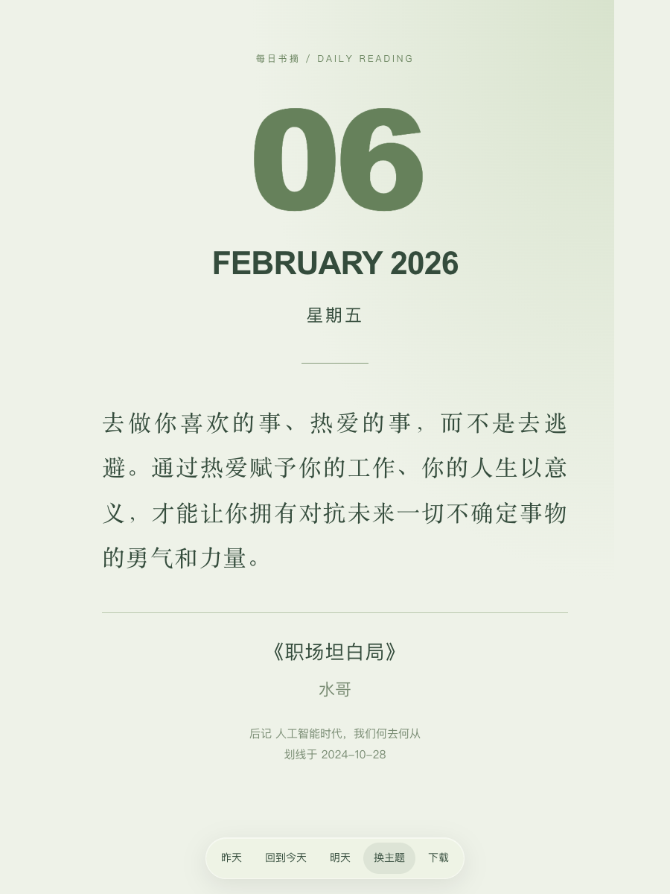
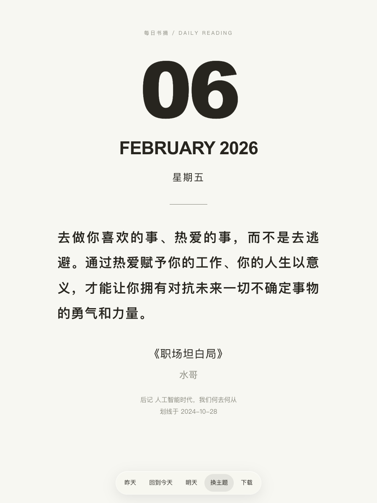
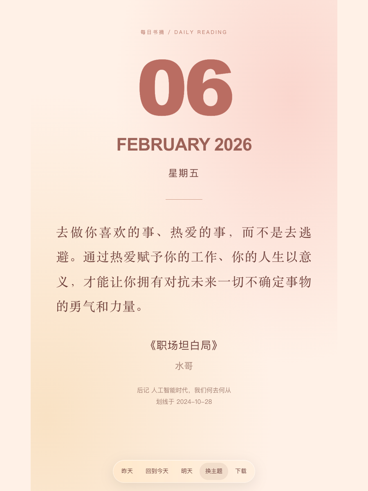
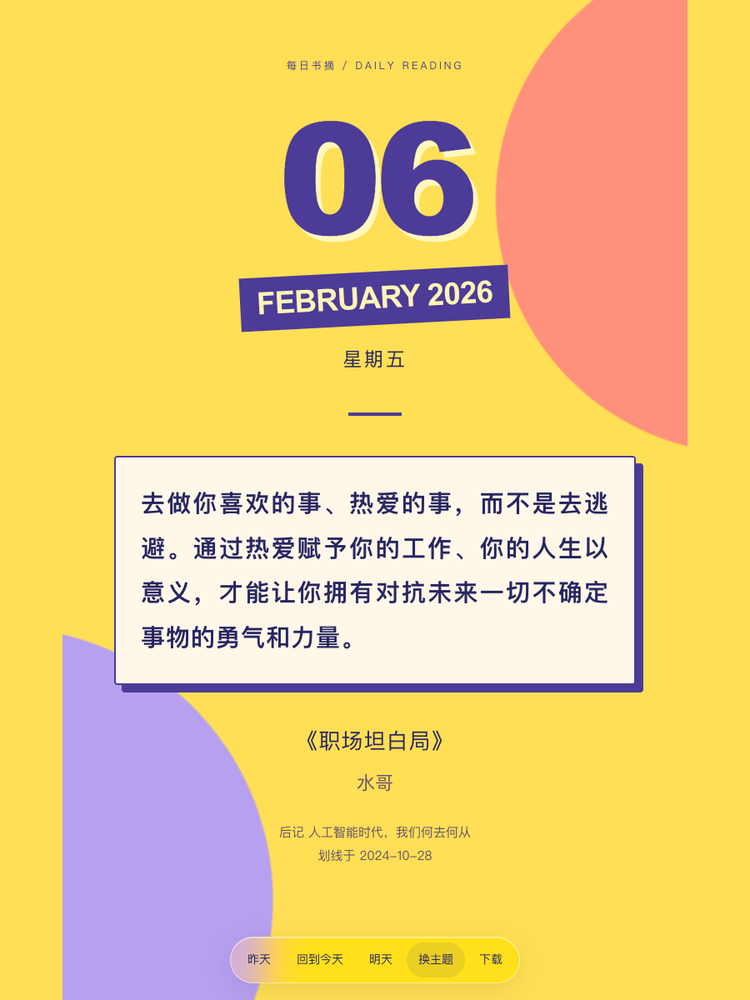
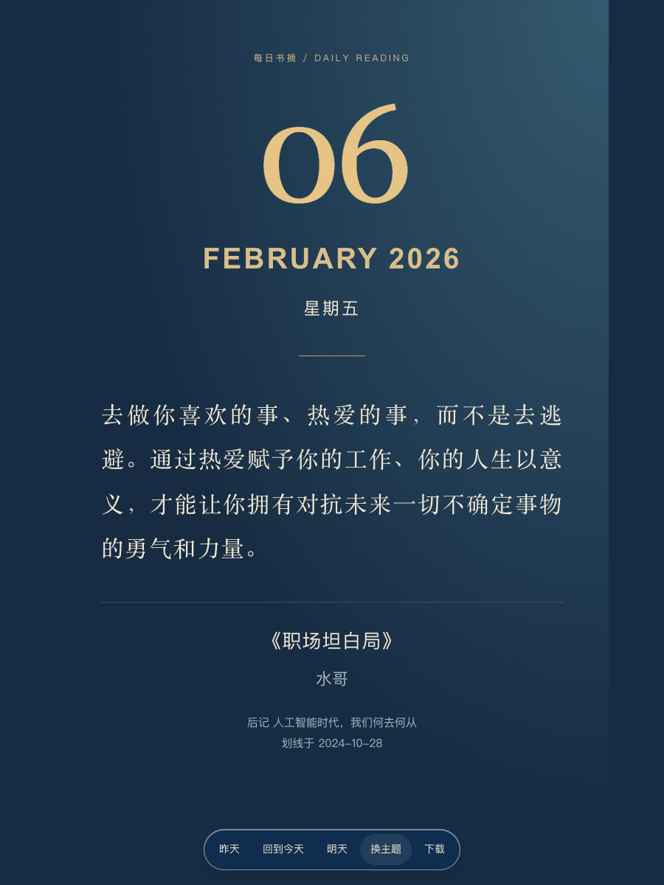

# 每日书摘 · 阅读万年历

把读过时心动的句子，放回日常。

**[打开在线体验](https://kemengs-oss.github.io/weread-calendar-demo/)** · [查看撞色主题](https://kemengs-oss.github.io/weread-calendar-demo/?date=2026-02-06&theme=pop)

从个人微信读书的 1000 条划线中，获用户授权精选 **100 条，覆盖 81 本书**，用于公开展示。其余 900 条不在本仓库中。原文、书名、作者、章节与划线日期取自导出数据；源数据缺失的字段不补造。

## 示例图片

| 鼠尾草绿 | 黑白简约 | 暖杏柔粉 | 缤纷撞色 | 深蓝夜读 |
| --- | --- | --- | --- | --- |
|  |  |  |  |  |

示例图均为宽 900 × 高 1200（高:宽＝4:3），展示同一天的五种主题。点击图片可查看原图。

## 可以体验什么

- 2026 年全年 365 天日历，昨天 / 回到今天 / 明天翻页。
- 五种主题，切换时保留当前日期与书摘。
- 将当前卡片下载为 PNG，图片不包含悬浮按钮。
- 书名可跳转微信读书；链接进入书籍，不能保证定位到对应划线。
- 尽量跨书交错展示；100 条书摘全年轮换重读，不表示每天原文都不重复。

这是固定的公开体验快照，不联网拉取微信读书数据，也不包含 API Key、邮箱或自动同步任务。任何访客都能访问这 100 条书摘的数据文件。历史日期表示日历安排，不表示当时已经划线或推送。

## 本地运行

在仓库根目录运行：

```sh
python3 -m http.server 8080
```

访问 http://localhost:8080/docs/ 。页面支持子路径托管，适用于 GitHub Pages 项目站点。

## GitHub Pages

发布源：`main` 分支的 `/docs` 目录。`docs/.nojekyll` 禁用 Jekyll 处理，页面和数据均为静态文件，无需构建或密钥。

后续年份需重新生成并提交日历；本版本固定为 2026 年。

## 验证

已验证项目子路径资源加载、五主题切换、日期翻页、年初年末边界、320px 窄屏布局及浏览器 PNG 下载。普通浏览器验证适用于这个网页版本，不代表小红书容器或手机相册保存验收。

## 许可

自有代码采用 MIT。浏览器 PNG 导出依赖 html-to-image 1.11.13（MIT），许可证在 `docs/vendor/` 随包提供。书摘及原书内容的权利归原权利人，不属于本仓库 MIT 授权范围。
